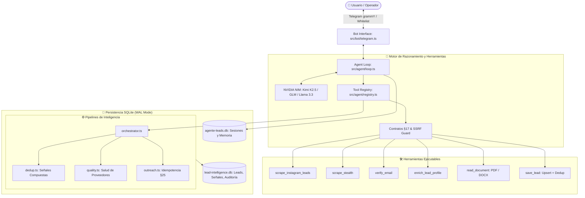

# 🏛️ 01 — Arquitectura General de AGENTE LEADS

## 1. Diagrama de Flujo del Sistema

---

## 2. Capas Principales del Sistema

### A. Capa de Interfaz y Seguridad (`src/bot/telegram.ts`)
- Utiliza **grammY** con Long Polling. No requiere puertos abiertos ni certificados SSL.
- **Middleware de Whitelist**: Valida `ALLOWED_IDS` contra los IDs numéricos autorizados en `.env`. Cualquier usuario no autorizado es bloqueado de inmediato.
- Comandos nativos:
  - `/start`: Bienvenida y presentación del rol.
  - `/clear`: Reinicio de contexto conversacional en la base de datos.
  - `/memory`: Inspección de recuerdos clave retenidos sobre el usuario.

### B. Capa del Bucle Agéntico (`src/agent/loop.ts`)
- Reconstruye el contexto del historial reciente desde SQLite.
- Ejecución paralela de herramientas (`Promise.all`) cuando el LLM emite múltiples llamadas simultáneas, reduciendo la latencia hasta en un 90%.
- Prompt del sistema con directivas de **Self-Healing**:
  - Normalización de correos (`[at]` $\rightarrow$ `@`).
  - Reformulación automática de búsquedas vacías con sinónimos.
  - Generación de reportes estructurados para Telegram.

### C. Capa de Contratos y Auditoría (`src/agent/tools/contracts.ts`)
- Cada tool define sus permisos (`READ`, `WRITE`, `NETWORK_OUTBOUND`), nivel de riesgo (`LOW`, `MEDIUM`, `HIGH`) y tiempo límite de ejecución.
- Incluye **SSRF Guard**: Previene peticiones maliciosas hacia redes privadas (`127.0.0.1`, `10.0.0.0/8`, metadata cloud, etc.) cuando se procesan URLs externas.
- Registro de auditoría persistido tras cada ejecución de herramienta.
